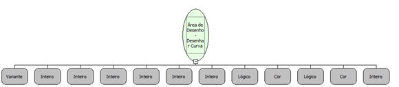

Descrição:

Desenha curva quadrática na área de desenho passada como parâmetro.

Parâmetros:

1. Área de Desenho.

2. Coordenada X inicial.

3. Coordenada Y inicial.

4. Coordenada X do ponto máximo ou mínimo.

5. Coordenada Y do ponto máximo ou mínimo.

6. Coordenada X final.

7. Coordenada Y final.

8. Valor lógico que informa se a área será preenchida.

9. Cor de preenchimento.

10. Valor lógico que informa se a área será delineada.

11. Cor da borda.

12. Espessura da borda.

Retorno:

Não possui.

Nome real:

ebfCanvasDrawQuadraticCurve

Compatibilidade:

Cliente
