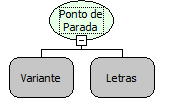

Descrição:

Essa função determina um ponto de parada de uma função ou regra, ela serve pra encontrar e corrigir os erros (bug's), acompanhando passo a passo o que está sendo feito.

Parâmetros:

1. Função ou Regra

2. Comentário, algo que queira informar naquele Ponto de Parada (OPCIONAL).

Retorno:

Não possui.

Exemplo:

Assumindo que o 1º parâmetro seja a função Soma e o 2º parâmetro seja "Parou na função soma". Ao executar a função "Parar na Função Soma", deve-se verificar a função e dar continuidade a mesma,  entrar na configuração do sistema e apertar o botão regras que mostra o nome da regra e o seu status.

Nome Real:

breakPoint

Compatibilidade:

Servidor
