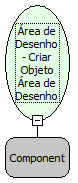

Descrição:

Cria uma referência para o "Objeto Área de Desenho" e a retorna. Este objeto é necessário para que seja utilizada as demais funções da categoria Desenho.

Parâmetros:

1. Moldura que será utilizada como referência para a criação dos desenhos.

Retorno:

Retorna a referência do objeto. (Variante)

Nome Real:

ebfCanvasCreate

Compatibilidade:

Cliente
