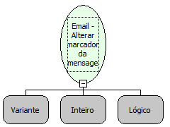

Descrição:

Altera o valor do marcador(flag) passado como parâmetro da mensagem

Parâmetros:

1. Mensagem (Função: Email - Mensagens em uma pasta)

2. Marcador da mensagem

3. Valor para o marcador

Observações:

1. Para o marcador de deleção das mensagens com protocolo POP3, é necessário usar a função "Email - Fechar pasta do repositório de emails" com o segundo parâmetro verdadeiro.

2. Valores para os marcadores da mensagem:

 1. Respondida

 2. Deletada

 3. Rascunho

 4. Assinalar

 5. Recente

 6. Lida

 7. Requerida

Exemplo:

1º Parâmetro: Mensagem

2º Parâmetro: 2

3º Parâmetro: Verdadeiro

Nome Real:

ebfEmailSetFlag

Compatibilidade:

Servidor
