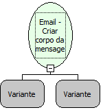

Descrição:

Cria o conteúdo do email. O conteúdo pode ser texto, html e anexo.

Parâmetros:

1. Lista de Parâmetros

               1. Tipo do conteúdo (Ver observação 1)

               2. Valor do conteúdo

N. Lista de Parâmetros

               1. Tipo do conteúdo (Ver observação 1)

               2. Valor do conteúdo

Retorno:

Corpo da mensagem

Observação:

O tipo do conteúdo pode ser "texto"(texto normal), "html"(texto em html) ou "anexo"

Nome Real:

ebfSMTPCreateMessageBody

Compatibilidade:

Servidor
