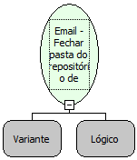

Descrição:

Fecha a pasta do repositório de emails

Parâmetros:

1. Pasta do email (Função: Email - Obter pasta do repositório de emails)

2. Apagar mensagens marcadas como deletadas

Observações:

1. Mensagens não podem ser lidas caso a pasta a qual ela pertença esteja fechada.

2. O segundo parâmetro só é válido para conexões com o protocolo POP3.

Exemplos:

1º Parâmetro: pasta INBOX

2º Parâmetro: Verdadeiro

Nome Real:

ebfEmailCloseFolder

Compatibilidade:

Servidor
