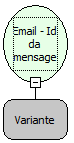

Descrição:

Obtém o identificador único da mensagem passada como parâmetro.

Parâmetros:

1. Mensagem (Função: Email -  Mensagens em uma pasta).

Retorno:

Identificador da mensagem.

Exemplos:

1º Parâmetro: Mensagem  Retorno: "&lt;27117501.441199967041995.JavaMail.SYSTEM@APOLO&gt;"

Nome Real:

ebfEmailGetMessageId.

Compatibilidade:

Servidor
