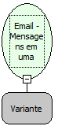

Descrição:

Retorna uma lista com todas as mensagens contidas em uma pasta do repositório de emails.

Parâmetros:

1. Pasta do repositório de emails. (Função: Email - Obter pasta do repositório de emails)

Retorno:

Lista de mensagens contidas na pasta do repositório de emails.

Exemplos:

1º Parâmetro: Pasta do repositório de emails. Retorno: Lista de mensagens.

Observação:

1. Para manipular o retorno desta função e necessário o uso das FUNÇÕES DE LISTA.

Nome Real:

ebfEmailListMessages

Compatibilidade:

Servidor
