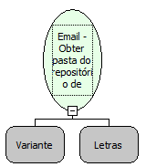

Descrição:

Obtém uma pasta do repositório de emails passado como parâmetro

Parâmetros:

1. Repositório de emails (Função: Email - Repositório de emails)

2. Nome da pasta

Retorno:

Pasta do repositório de emails

Observação:

A pasta é aberta automaticamente

Exemplo:

1º Parâmetro:Repositório de emails

2º Parâmetro:"INBOX"

Retorno: Pasta "INBOX" do repositório de emails

Nome Real:

ebfGetEmailFolder

Compatibilidade:

Servidor
