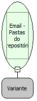

Descrição:

Retorna uma lista com os nomes das pastas existentes no repositório de emails

Parâmetros:

1. Repositório de emails (Função: Email - Repositório de emails)

Retorno:

Lista com o nome das pastas contidas no repositório de emails

Observação:

Para manipular o retorno da função é necessário o uso das FUNÇÕES DE LISTA

Exemplo:

1º Parâmetro: Repositório de emails

Retorno: Lista com o nome das pastas

Nome Real:

ebfEmailListFolders

Compatibilidade:

Servidor
