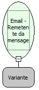

Descrição:

Obtém o remetente da mensagem passada como parâmetro

Parâmetros:

1. Mensagem (Função: Email -  Mensagens em uma pasta)

Retorno:

Remetente da mensagem

Exemplo:

1ºParâmetro: Mensagem

Retorno: "suporte@softwell.com.br"

Nome Real:

ebfEmailGetMessageFrom

Compatibilidade:

Servidor
