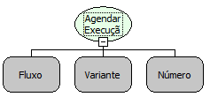

Descrição:

Agenda a execução de um fluxo para ser executado após um determinado tempo, sem vínculo de quem o chamou.

Parâmetros:

1. Digite o nome da regra. (Letras)

2. Lista de parâmetros da regra

3. Tempo para a regra ser executada, em milissegundos

Observações:

1. Fluxo cliente somente agenda para a camada CLIENTE, e servidor somente para a camada SERVIDOR, para agendar fluxos de outra camada utilize um subfluxo para agendar;

2. Fluxo servidor não interage com a tela, funções como "Habilitar Controle" ou mensagens não serão exibidos.

Nome Real:

ebfRuleSchedulerNoParent

Compatibilidade:

Cliente e Servidor.
