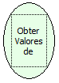

Descrição:

Obtém os valores que foram passados por parâmetro para o fluxo em que essa função se encontra e retorna-os em uma lista.

Parâmetros:

Não possui.

Retorno:

Lista que contém os valores.

Nome Real:

ebfGetInputValues

Compatibilidade:

Servidor
