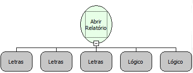

Descrição:

Abre um relatório no contexto chamado, sem desviar para uma tela ou perguntar por parâmetros

Parâmetros:

1. Código/Nome do Relatório

2. Parâmetros do Relatório

3. Tipo do relatório gerado (PDF, HTM, JPG, XLS, TXT, SCR)

4. Abrir em uma nova janela?

5. Usar o gerador local?

Observações:

1. O tipo SCR que pode ser informado no 3º parâmetro desta função está relacionado à abertura

do relatório em tela.

2. Caso o relatório tenha sido criado no RB7 (Gerador de Relatórios legado), o filtro funciona da seguinte forma: CAMPO=valor

2.1 Caso o relatório tenha sido criado no RB10, o filtro deve ser o nome do parâmetro definido no critério da consulta. parâmetro1=valor

2.2 Caso queira definir vários parâmetros, basta separá-los por ;

      Ex: (parâmetro1=valor;parâmetro2=valor2)

3. Caso o relatório possua o filtro between (Entre), deve ser utilizada ao fim a expressão _copy. Ex: campo = valor ; campo_copy = valor; As datas devem ser separadas por ponto e vírgula e o copy deve ser todo minúsculo.

Nome Real:

ebfOpenReportInline

Compatibilidade:

Todas as camadas
