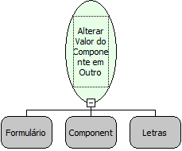

Descrição:

Altera o valor de um componente que esteja em outro formulário que não o corrente.

Parâmetros:

1. Formulário

2. Componente

3. Novo Valor

Retorno:

Não possui.

Observação:

Está função não altera o valor do componente Lista Dinâmica. Para isso utilize a função: Alterar Valor da Lista Dinâmica.

Nome Real:

ebfChangeComponentValueOtherForm

Compatibilidade:

Cliente
