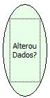

Descrição:

A função retorna um valor lógico (Verdadeiro ou falso) informando se o componente foi ou não alterado.

Parâmetros:

Não Possui.

Retorno:

Não Possui.

Observação:

Essa função deve ser utilizada em uma decisão. É recomendável utilizar no evento "Antes de Alterar".

Nome Real:

ebfFormHasChanged

Compatibilidade:

Servidor
