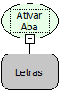

Descrição:

Esta função permite ativar e focar a aba descrita no primeiro parâmetro.

Parâmetros:

1. Nome da Aba a ser ativada.

Retorno:

A aba selecionada para regras cliente. Para regras servidor retorna Nulo.

Exemplo:

Assumindo como parâmetro a aba "Endereço"(Letras), quando o fluxo for executado a aba "Endereço" será habilitada.

Nome real:

ebfFormOpenTab

Compatibilidade:

Cliente e Servidor
