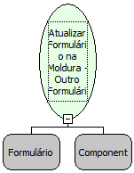

Descrição:

A função atualiza o registro corrente de um formulário que está em uma moldura a partir de outro formulário.

Parâmetros:

1. Formulário onde a moldura se encontra

2. Moldura onde se encontra o outro formulário

Retorno:

Não Possui.

Nome Real:

ebfRefreshBevelOtherForm

Compatibilidade:

Cliente e Servidor
