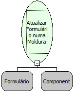

Descrição:

Atualiza um formulário aberto através da função "Abrir formulário numa moldura".

Parâmetros:

1. Formulário onde se encontra o componente moldura.

2. Nome do componente (Moldura).

Retorno:

Esta função não possui retorno.

Nome Real:

ebfFrameRefreshForm

Compatibilidade:

Cliente e Servidor
