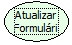

Descrição:

A função atualiza o formulário onde está o evento sem interação de confirmação com o usuário.

Parâmetros:

Não Possui

Retorno:

Não Possui.

Observações:

1. Se essa função for executada antes de salvar alterações feitas no formulário, estas serão perdidas, pois a essa função traz os dados existente no banco.
2. Indicada para atualizar formulário Modal
3. Esta função deve ser utilizada em formulário com consulta.

Nome Real:

ebfRefreshFormModal.

Compatibilidade:

Cliente e Servidor.
