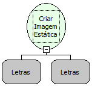

Descrição:

Cria uma imagem estática em um componente moldura.

Parâmetros:

1. Nome da moldura (usada no formulário para exibir a imagem).

2. Endereço onde está armazenada a imagem na Internet.

Retorno:

Variante.

Exemplo:

Nome da URL (Localizador Uniforme de Recursos) http://www.softwell.com.br/downloads/Foto.jpg

Nome Real:

ebfFormCreateImage

Compatibilidade:

Cliente
