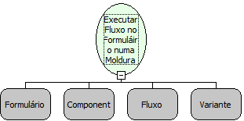

# Executar Fluxo no Formulário numa Moldura

Descrição:

Executa um fluxo em um formulário que esteja aberto em uma moldura.

Parâmetros:

1. Formulário

2. Componente (Moldura)

3. Fluxo

4. Lista de Parâmetros

Retorno:

Não possui.

Nome Real:

ebfExecuteRuleOnFormOpenedBevel

Compatibilidade:

Cliente
