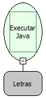

Descrição:

Executa um comando Java passado como parâmetro

Parâmetros:

1. Comando Java

Retorno:

Retorna o resultado do comando executado tem que ser atribuído a uma variavel

Observações:

1. Java é uma linguagem computacional completa, adequada para o desenvolvimento de aplicações baseadas na rede Internet, redes fechadas ou ainda programas stand-alone [CAM96]. Para saber mais sobre o assunto, pesquise em um site de busca sobre Java.

2. O retorno tem que ser sempre um Variante

3. Essa função é usada para a necessidade de executar um comando Java

Exemplo:

1° Parâmetro:  String resultado = "Maker" + "Flow"; return VariantPool.get(resultado);

Nome Real:

executeJavaFunction

Compatibilidade:

Servidor
