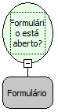

Descrição:

Verifica se o formulário passado como parâmetro está aberto.

Parâmetros:

1. Formulário

Retorno:

Retorna verdadeiro se o formulário estiver aberto.

Nome Real:

formIsOpenned

Compatibilidade:

Cliente
