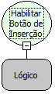

Descrição:

Habilitar Botão de Inserção

Parâmetros:

1. Lógico (Verdadeiro para Habilitar, Falso para Desabilitar)

Retorno:

Não Possui.

Nome Real:

ebfEnableIncludeButton

Compatibilidade:

Cliente
