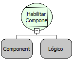

Descrição:

Esta função habilita o componente se a condição passada no segundo parâmetro for verdadeira, ou desabilita caso a condição seja falsa. Se o componente estiver desabilitado, não será possível modificar seu conteúdo.

Parâmetros:

1. Componente que será habilitado ou desabilitado.

2. Condição para habilitar o componente

Retorno:

Não Possui.

Exemplos:

1. Assumindo como parâmetros o componente "Cidade" (MakerEdit1), e uma condição lógica "Ano Atual= 2000", quando a função for executada, caso o Ano atual seja 2000 o componente "MakerEdit1" será habilitado, Caso seja diferente de 2000 o campo será desabilitado.

2. Assumindo como parâmetros o componente "Cidade" (MakerEdit1), e uma condição lógica true, quando a função for executada o componente sempre vai ser habilitado.

Observações:

1. Para selecionar o componente é necessário indicar o nome do formulário no de trabalho no "Inicio" do fluxo .

2. Caso não queira selecionar o formulário de trabalho, digite o nome do componente mudando a constante do tipo "formulário"

para uma constante do tipo "Letras".

Nome Real:

ebfFormSetEnabled

Compatibilidade:

Cliente e Servidor
