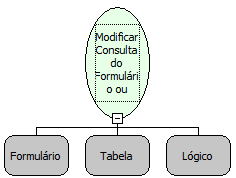

Descrição:

Modifica a consulta de um formulário ou um formulário de uma grade. Utilizado quando se deseja modificar a consulta associada ao formulário ou grid.

Parâmetros:

1. Formulário ou Grade (formulário vinculado ao componente grade).

2. Tabela navegável. Ex: tabela obtida através da função Abrir Consulta Navegável.

3. Atualizar formulário ou grade do Parâmetro 1?

Observações:

1. No caso de formulário, a seleção deve ser compatível com a seleção de origem, ou seja, os mesmo campos devem

estar presentes em ambos (já que trata-se de uma nova associação de dados ao formulário sendo a consulta anterior

fechada (O mesmo não vale quando existem Alias configurados aos campos)). Sendo uma grade, todos os campos

podem ser alterados.

2. Ao modificar a consulta do formulário, a nova consulta deixa de ser gerenciada pelo fluxo, ou seja, ele não se

encarregará de fechá-la, pois isso deverá ser uma tarefa do gerenciador do formulário (que a fechará quando o formulário

for fechado).

Nome Real:

ebfDefineFormResultSet

Compatibilidade:

Servidor
