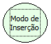

Descrição:

Esta função muda o modo do formulário para o modo de inserção.

Parâmetros:

Não Possui.

Retorno:

Não Possui.

Exemplo:

Caso um formulário esteja em modo de inserção, após a função ser chamada, o formulário passará para o modo de inserção.

Observações:

1. O formulário que vai entrar em modo de alteração será o mesmo que chama o fluxo.

2. O formulário deve estar com o modo de inclusão habilitado (Definições do Formulário) para que esta função tenha efeito.

Nome Real:

ebfFormInsertMode

Compatibilidade:

Cliente
