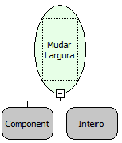

Descrição:

Esta função altera a largura do componente do formulário.

Parâmetros:

1. Componente que mudará de tamanho.

2. Nova largura do componente.

Retorno:

Não Possui.

Exemplo:

Assumindo como parâmetros o componente "Cidade"  (MakerEdit1), e o valor 350 (inteiro), quando o fluxo for executado a largura do componente passará a ser 350.

Observações:

1. Para selecionar o componente é necessário indicar o nome do formulário de trabalho no "Inicio" do fluxo   .

2. Caso não queira selecionar o formulário de trabalho, digite o nome do componente mudando a constante do tipo "formulário" para uma constante do tipo "Letras".

Nome Real:

ebfFormSetWidth

Compatibilidade:

Todas as camadas
