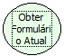

Descrição:

Obtém a referência do formulário no qual foi associado (ao evento do formulário) o fluxo de ação que contém esta função.

Parâmetros:

Não Possui.

Retorno:

Referência do Formulário. (Variante).

Nome Real:

ebfGetActualForm

Compatibilidade:

Cliente
