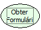

Descrição:

Obtém a referência do formulário principal, sendo este o chamador; normalmente abertos através de botões, dentre outros.

Parâmetros:

Não possui.

Retorno:

Referência do Formulário Principal a partir do qual o formulário atual foi aberto.
