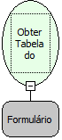

Descrição:

Esta função obtém a tabela vinculada ao formulário passado como parâmetro.

Parâmetros:

1. Formulário.

Retorno:

Retorna a tabela vinculada ao formulário escolhido.

Nome Real:

ebfGetFormResultset

Compatibilidade:

Servidor
