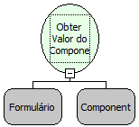

Descrição:

Obtém o conteúdo do componente passado no segundo parâmetro e o retorna.

Parâmetros:

1. Nome do Formulário.

2. Nome do Componente.

Retorno:

Retorna o conteúdo do componente passado como parâmetro (Letras).

Exemplo:

Desejando obter o valor de um componente "CID_COD", estando este em um formulário "Cidade", passaria como parâmetros:

1° Parâmetro: Formulário "Cidade"

2° Parâmetro: Componente "CID_COD"

Retorno: Conteúdo do componente "CID_COD".

Observações:

1. Para obter o valor de um componente que se encontra em um Sub Form, deve ser passado o formulário do Sub Form como parâmetro.

2. Para obter o valor de um componente que se encontra em outro formulário, utilize a função "Obter Valor do Componente do Formulário".

3. Para obter o valor de um componente que se encontra em uma moldura, deve ser utilizada a função "Executar Fluxo no Formulário" e apontar para um fluxo que chama esta função.

Nome Real:

ebfFormGetComponentValue

Compatibilidade:

Cliente
