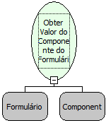

Descrição:

Obtém o conteúdo de um componente do formulário principal ou de qualquer outro passado como parâmetro.

Parâmetros:

1. Formulário onde se localiza o componente a ser obtido o valor.

2. Campo do qual se deseja obter o valor.

Retorno:

Conteúdo do campo passado como parâmetro.

Observações:

1. Para essa regra funcionar como servidor, é necessário que o componente esteja associado a um campo da tabela.

2. Se não for o formulário principal (que chama o fluxo) e o mesmo estiver aberto, o retorno será o conteúdo do campo passado naquele registro. Caso o formulário passado não esteja sendo utilizado, o retorno será o primeiro registro no banco.

3. Para obter o valor de um componente que se encontra em um Sub Form, deve ser passado o formulário do Sub Form como parâmetro.

Exemplo:

No formulário "Cadastro" cujo conteúdo do campo "Cidade" é "Salvador", assumindo como parâmetros Cadastros (Formulário), "Cidade" (Campo), o retorno seria "Salvador".

Nome Real:

ebfSQLGetFieldFromForm

Compatibilidade:

Cliente e Servidor
