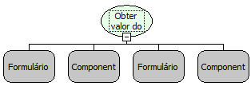

Descrição:

Obtem o valor de um componente contido em um formulário aberto numa moldura.

Parâmetros:

1. Formulário onde se encontra a moldura

2. Nome do componente moldura

3. Formulário que será aberto na moldura

4. Componente que será obtido o valor

Retorno:

Valor do componente que se encontra na moldura

Nome Real:

ebfBevelGetComponentValue

Compatibilidade:

Cliente
