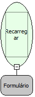

Descrição:

Recarrega o formulário passado como parâmetro.

Parâmetros:

1. Formulário a ser recarregado.

Retorno:

Não possui

Exemplo:

Em um formulário "Pessoa", ao ser chamada a função Recarregar Formulário, todos os campos são atualizados.

Nome Real:

ebfResetForm

Compatibilidade:

Servidor
