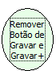

Descrição:

Remove os botões de Gravar e Gravar+ do formulário.

Parâmetros:

Não possui.

Retorno:

Não possui.

Observação:

Esta função remove os botões de Gravar e Gravar+ do modo de Inserção/alteração.

Nome Real:

ebfRemoveSaveButtons

Compatibilidade:

Todas as camadas
