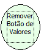

Descrição:

Remove o botão de valores padrão do formulário.

Parâmetros:

Não possui.

Retorno:

Não possui.

Observação:

Esta função deve ser utilizada no evento ao entrar.

Nome Real:

ebfRemoveDefaultValuesButton

Compatibilidade:

Cliente
