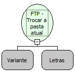

Descrição:

O diretório de trabalho remoto inicialmente será o diretório home do usuário. Para mudá-lo basta usar essa função, passando o nome do novo diretório como argumento.

Parâmetros:

1. Um Objeto FTP (Variante) que represente uma conexão FTP aberta.

2. Novo diretório de trabalho.

Retorno:

Não possui.

Nome Real:

ebfFTPAlterFolder

Compatibilidade:

Servidor
