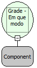

Descrição:

Verifica o estado da grade passada por parâmetro, retornando 'I' caso esteja em modo de inserção, 'A' caso esteja em modo de edição, ou 'N' se não for nenhum dos dois casos.

Parâmetros:

1. Nome da Grade

Retorno:

Retorna em que modo a grade está: 'I' se estiver em modo de inserção, 'A' se em modo de edição, 'N' se não for nenhum dos dois casos anteriores.

Exemplo:

Assumindo a grade passada por parâmetro está em modo de inserção. Ao chamar o fluxo o retorno será 'I'.

Nome Real:

ebfWhatIsGridModeStatus

Compatibilidade:

Cliente
