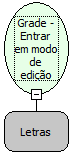

Descrição:

Entra em modo de edição com a grade.

Parâmetros:

1. Nome da grade

Retorno:

Não possui.

Observações:

 1. Só funciona se a grade não estiver em modo de inserção

 2. A grade precisa estar com uma linha selecionada, caso contrario, entrará em modo de edição com a primeira linha.

Nome Real:

ebfGridEditableEdit

Compatibilidade:

Cliente
