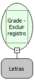

Descrição:

Exclui o registro selecionado da grade editável passada como parâmetro.

Parâmetros:

 1. Nome da grade (Letras)

Retorno:

Não possui.

Observação:

A grade precisa ser editável

Nome Real:

ebfGridEditableDeleteRow

Compatibilidade:

Cliente
