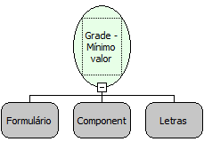

Descrição:

Obtem o menor valor de uma determinada coluna. Os parâmetros passados correspondem ao nome do formulário, o nome da grade e o campo que terá seus valores comparados.

Parâmetros:

1. Nome do Formulário

2. Nome da Grade

3. Nome do Campo

Retorno:

Valor mínimo referente ao campo informado (Número)

Exemplo:

GRADE:   USUARIO

Campos: CODIGO,NOME,IDADE

No campo IDADE existe os valores: ( 18;25;14;32;30;29 )

Os parâmetros passados para a função serão:

- Nome do Formulário

- Nome da grade (USUARIO)

- Nome do campo (IDADE)

O valor retornado será: (14)

Observações:

1. RESULTADOS DA FUNÇÃO:

A função, quando usada no 'fluxo cliente', retorna o MÍNIMO valor encontrado apenas dos dados visualizados na grade. Caso estiver sendo usada a "paginação" na grade, os valores das páginas omitidas não serão verificados. Já os fluxos do modo Servidor, a verificação dos valores é feita em todos os registros da grid (podendo estes estarem paginados ou não). O fluxo se em camada Servidor sempre retorna o valor em Fracionado.

2. MODO INSERÇÃO OU ALTERAÇÃO

Caso a função venha a ser usada com o formulario estando no modo de inserção ou alteração, deverá ser usado um fluxo do modo cliente para que se obtenha o resultado.

Nome real:

ebfGridMinColumn

Compatibilidade:

Cliente e Servidor
