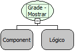

Descrição:

Esta função exibe ou esconde a barra de edição de um componente grade passado como parâmetro.

Parâmetros:

1. Componente

2. Valor lógico

Retorno:

Não possui.

Observação:

A barra de edição é a interface de inserção, atualização, edição e exclusão.

Nome Real:

ebfGridSetVisibleMainButtons

Compatibilidade:

Cliente
