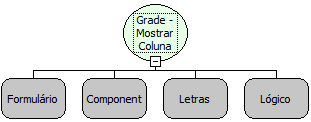

Descrição:

Esta função mostra a coluna de uma grade se a condição passada no quarto parâmetro for verdadeira, ou oculta caso a condição seja falsa.

Parâmetros:

1. Formulário que contém a grade

2. Componente Grade

3. Nome da coluna

4. Condição para mostrar a coluna

Retorno:

Não Possui.

Observação:

É possível obter os valores da coluna mesmo após ter sido ocultada.

Nome real:

ebfGridShowColumn

Compatibilidade:

Cliente
