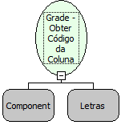

Descrição:

Essa função retorna o código da coluna. Informando a Grade e o nome da coluna que deseja saber o código.

Parâmetros:

1. Nome da Grade

2. Nome da Coluna

Retorno:

Retorna o código da coluna.

Exemplo:

Assumindo o 1º parâmetro sendo "Venda" e o 2º parâmetro "Produto". Passando esse parâmetro, o retorno será o código da coluna "Produto".

Nome Real:

ebfGridColumnCode

Compatibilidade:

Cliente
