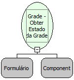

Descrição:

Função que retorna estado da grade.

Parâmetros:

1. Formulário onde o componente do tipo grade se encontra;

2. Componente do tipo grade.

Retorno:

"edição" - se a grade estiver em modo de edição.

"inserção" - se a grade estiver em modo de inserção.

"normal" - se estiver em modo normal.

Nome Real:

ebfGridGetStatus

Compatibilidade:

Servidor
