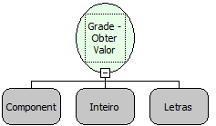

Descrição:

Essa função retorna o valor que está na Grade, a partir da informação da linha (a primeira linha da Grade é a linha "0" (zero)) e a coluna que deseja obter o valor.

Parâmetros:

1. Componente Grade

2. Número da Linha (N-1)

3. Nome da Coluna

Retorno:

Valor obtido. (Letras)

Exemplo:

Assumindo o 1º parâmetro sendo "Registros", o 2º sendo 2 e o 3º parâmetro sendo "Nome". Passando esse parâmetro, o retorno será o valor que está na linha 3 da coluna "Nome" da Grade "Registros".

Observação:

O primeiro parâmetro desta função também pode ser modificado para a "Constante" do tipo "Letras", sendo informado manualmente o nome do componente "Grade".

Nome Real:

ebfGridGetValue

Compatibilidade:

Cliente
