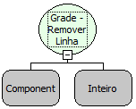

Descrição:

Essa função remove uma Linha da Grade. Passando como parâmetro a Grade e o número da linha que deseja remover.

Parâmetros:

1. Nome da Grade

2. Número da Linha (De 0 à N)

Exemplo:

Assumindo o 1º parâmetro sendo "Carros" e o 2º sendo 2. Ao chamar à função a Linha 2 será removida da Grade "Carros".

Nome Real:

ebfGridRemoveRow

Compatibilidade:

Cliente
