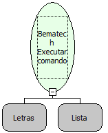

Descrição:

Essa função recebe como parâmetro uma constante do tipo letras que será um comando especifico do driver da Impressora Bematech, outro parâmetro do tipo Lista que será a lista de parâmetros que será passada para o comando  do driver  e retorna o Código do retorno do comando.

Parâmetros:

1. Comando especifico do Driver da Impressora Bematech

2. Lista de parâmetros

Retorno:

Código do retorno

Observação:

Para executar um comando do Driver da Impressora Bematech, antes tem que ser utilizada a função de Iniciar a Impressora cuja a documentação da função está na descrição da mesma.

Exemplo:

 Bematech Executar comando do Driver

 Parâmetro 1 : Le_Status (Comando especifico do Driver da Impressora Bematech)

 Parâmetro 2 : Status(Lista de parâmetros)

 Retorno : 44 (Código do retorno)

Nome Real:

ebfBematechDriverCommand

Compatibilidade:

Cliente
